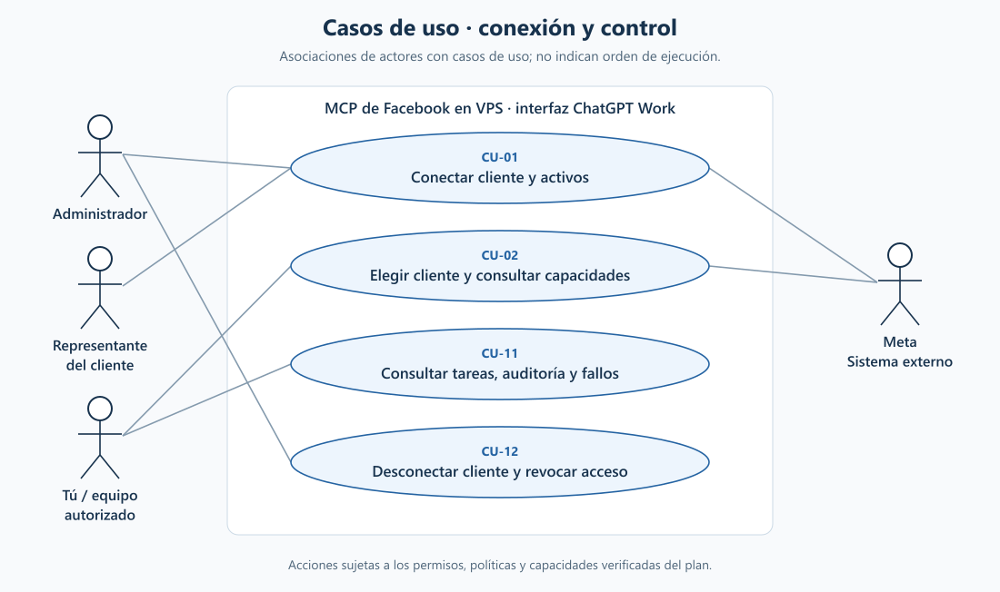
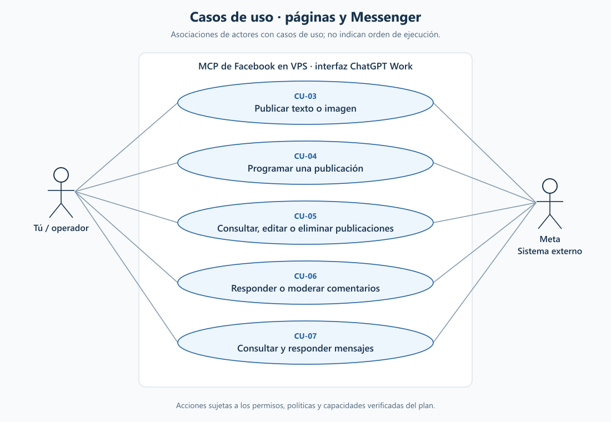
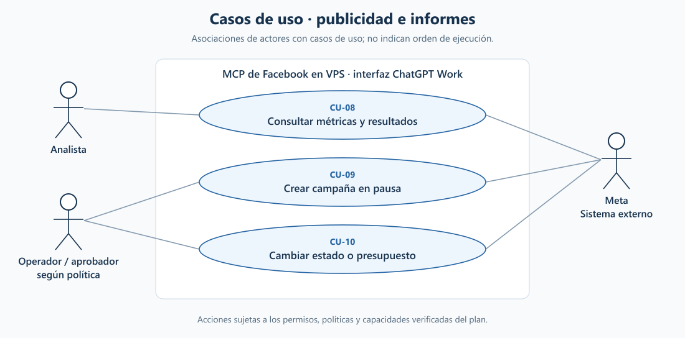
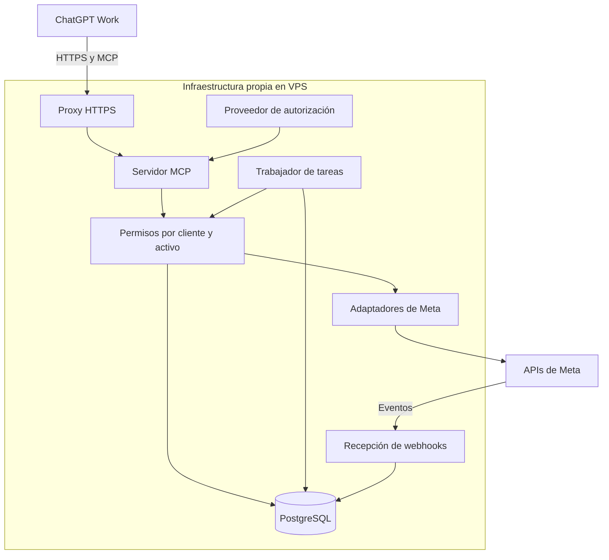
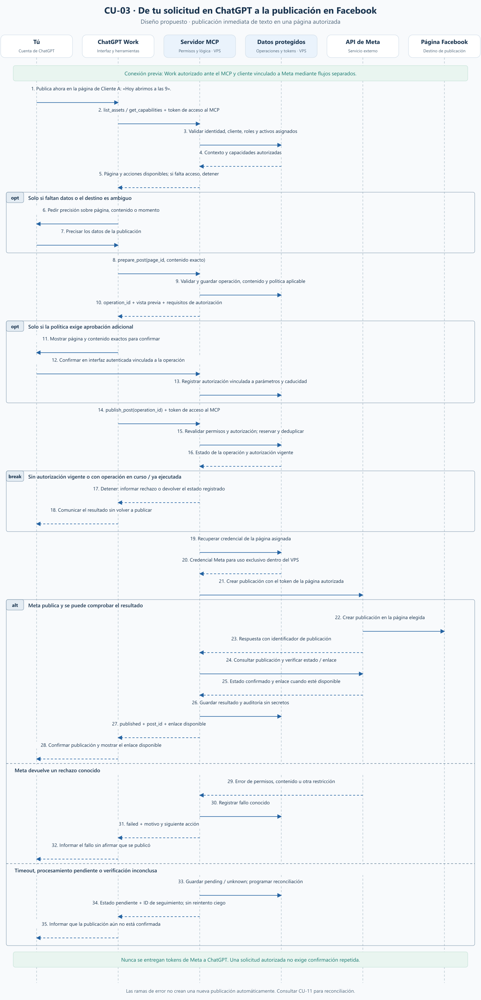

**Plan propuesto: MCP de Facebook para ChatGPT Work**

Fecha: 11 de octubre de 2026. Estado: propuesta; sin implementación ni despliegue.

El alcance confirmado comprende páginas, mensajes y anuncios, tanto propios como de clientes. El objetivo es administrar desde ChatGPT Work las operaciones que las APIs oficiales de Meta permitan sobre activos autorizados. La cobertura se medirá con una matriz de funciones verificadas; «administración total» no equivale a reproducir todos los controles de Facebook.

Al iniciar la planificación, el repositorio contenía únicamente un README. Se propone desarrollar un servicio para varios clientes con aislamiento de permisos y datos desde la primera versión. Toda la infraestructura propia de ejecución se alojará en VPS; ChatGPT y las APIs de Meta seguirán siendo servicios externos.

**1. Requisitos — definir qué podrá hacer cada usuario**

Inventariar clientes, páginas, cuentas publicitarias, operadores, volumen de mensajes y medios, monedas, zonas horarias y operaciones prioritarias. Definir perfiles internos de administrador, operador, analista y aprobador, con asignaciones por cliente y activo. Estos perfiles del MCP no sustituyen los permisos concedidos por Meta.

| Módulo | Funciones propuestas | Alcance de la primera entrega |
| --- | --- | --- |
| Clientes y conexión | Vincular Meta, seleccionar activos, consultar permisos, revocar acceso | Obligatorio antes de manejar información de clientes |
| Páginas | Consultar contenido, preparar borradores, publicar texto e imágenes, programar, editar y eliminar donde la API lo permita | Texto e imagen primero; vídeo, Reels y Stories se validan por separado |
| Comunidad | Consultar comentarios, responder, ocultar o eliminar cuando esté permitido | Cada acción se valida por endpoint y permiso |
| Estadísticas | Consultar resultados de páginas, publicaciones y anuncios | Catálogo de métricas vigente, con fechas, moneda y procedencia |
| Messenger | Consultar conversaciones y responder en nombre de una página | Respuestas asistidas desde Work; elegibilidad de envío validada en servidor |
| Anuncios | Consultar resultados; crear y modificar campañas, conjuntos y anuncios; pausar, activar y ajustar presupuestos | Crear en pausa por defecto; activación y gasto conforme a límites autorizados |
| Operación | Consultar tareas, resultados, errores y registro de acciones | Programaciones persistentes y estados verificables |

Leads, catálogos, administración de personas/roles del negocio y otras extensiones se evaluarán después del núcleo. Perfiles personales, buzón personal, grupos, pagos, recuperación de cuentas y controles de seguridad no forman parte de la cobertura comprometida.

Los requisitos transversales incluyen separación entre clientes, autorización por activo y acción, trazabilidad, manejo de caducidad de tokens, eliminación de datos, cuotas por cliente y recuperación de tareas. Las publicaciones y mensajes recibidos se tratarán como datos externos, sin autoridad para ordenar acciones al MCP.

Entregable: catálogo priorizado de casos de uso, roles, volúmenes y reglas de operación. Criterio de cierre: cada función tiene un usuario responsable, un activo, entradas y un resultado comprobable.

**1.1. Casos de uso descritos y gráficos**

Los siguientes casos representan el comportamiento previsto del sistema. Su disponibilidad final depende de la matriz de viabilidad y de los accesos concedidos por Meta. «Tú» es la persona que utiliza su cuenta de ChatGPT Work; puede actuar sobre sus activos o los de un cliente únicamente dentro de sus asignaciones autorizadas.

Los gráficos emplean actores, óvalos y un límite del sistema para representar casos de uso. Las líneas indican participación, no orden temporal ni permisos automáticos. ChatGPT Work es la interfaz; el MCP y sus servicios se ejecutan en el VPS; Meta es un sistema externo. Las fuentes Mermaid usan `flowchart` como representación visual, sin pretender una notación UML completa.

**Conexión y control**

[Abrir gráfico vectorial](diagrams/casos-acceso.svg) · [Fuente Mermaid editable](diagrams/casos-acceso.mmd)

**CU-01. Conectar un cliente y sus activos**

- **Actor y objetivo:** administrador del MCP, con el representante autorizado del cliente; habilitar la gestión de sus activos.
- **Precondiciones:** identidad autenticada, cliente registrado y representante con los permisos necesarios en Meta.
- **Flujo:** crear la conexión del cliente; completar la autorización en Meta; consultar activos disponibles; seleccionar páginas y cuentas publicitarias; asignar operadores y acciones internas.
- **Resultado y alternativas:** conexión registrada con capacidades verificadas. Si el consentimiento se cancela o faltan permisos, se informa qué funciones quedan pendientes y no se habilitan. La conexión de Work con el MCP y el consentimiento de Meta son procesos distintos.

**CU-02. Elegir cliente y consultar capacidades**

- **Actor y objetivo:** tú, operador o analista; establecer el cliente, la página o la cuenta sobre la que trabajar.
- **Precondiciones:** sesión válida y asignaciones a uno o más clientes.
- **Flujo:** consultar clientes autorizados; seleccionar un cliente y sus activos; consultar las operaciones disponibles y mantener ese contexto explícito en la solicitud.
- **Resultado y alternativas:** destino inequívoco y capacidades visibles. Si hay páginas con nombres similares se pide precisión; un identificador perteneciente a otro cliente no concede acceso ni permite una escritura.

**CU-11. Consultar tareas, auditoría y fallos**

- **Actor y objetivo:** operador o administrador asignado; conocer qué pasó con una solicitud y resolver incidencias.
- **Precondiciones:** acceso al cliente y al registro o tarea consultados.
- **Flujo:** buscar por identificador, activo o período; consultar estado, resultado y trazabilidad; solicitar reconciliación cuando el resultado sea incierto; reintentar únicamente si se demuestra que procede.
- **Resultado y alternativas:** estado confirmado, fallido, programado o pendiente, con la siguiente acción. Los registros no contienen secretos. Una operación incierta no se vuelve a publicar por defecto; si no puede determinarse su resultado, permanece pendiente de revisión.

**CU-12. Desconectar un cliente y revocar su acceso interno**

- **Actor y objetivo:** administrador autorizado; impedir nuevas operaciones de una conexión concreta.
- **Precondiciones:** identificación exacta del cliente y alcance de la desconexión, conforme a la política aplicable.
- **Flujo:** deshabilitar la conexión; bloquear nuevas solicitudes y tareas aún no ejecutadas; retirar acceso a credenciales; aplicar retención o eliminación de datos; registrar el resultado. Las peticiones ya enviadas a Meta se concilian para conocer su efecto.
- **Resultado y alternativas:** acceso interno revocado. Las publicaciones existentes permanecen en Facebook. La revocación del consentimiento en Meta, cuando corresponda, se gestionará mediante su mecanismo admitido y se distinguirá de la desconexión local.

**Páginas y Messenger**

[Abrir gráfico vectorial](diagrams/casos-paginas.svg) · [Fuente Mermaid editable](diagrams/casos-paginas.mmd)

**CU-03. Publicar texto o una imagen desde ChatGPT Work**

- **Actor y objetivo:** tú u otro operador autorizado; publicar contenido concreto en una página seleccionada.
- **Precondiciones:** Work conectado al MCP, autorización Meta vigente, página asignada y capacidad de publicación comprobada para el formato.
- **Flujo:** escribir la solicitud; resolver página, contenido y momento; preparar la operación; aplicar la autorización y política; ejecutar; comprobar el resultado en Meta y devolver evidencia.
- **Resultado y alternativas:** publicación confirmada con identificador y enlace cuando esté disponible. Solo se aclaran datos faltantes y solo se pide aprobación adicional si la política lo exige. Un rechazo se comunica como fallo; una respuesta incierta o pendiente se registra para reconciliación. Una imagen requiere validar también el archivo y su procesamiento.

**CU-04. Programar, reprogramar o cancelar una publicación**

- **Actor y objetivo:** operador autorizado; definir cuándo debe publicarse un contenido.
- **Precondiciones:** contenido y página definidos, fecha y hora válidas, zona horaria explícita y autorización para programar.
- **Flujo:** preparar el contenido; persistir la tarea; devolver su identificador; permitir cambios antes de que el trabajador tome la tarea; al vencer el plazo, revalidar permisos y ejecutar CU-03 desde el VPS.
- **Resultado y alternativas:** tarea consultable aunque el chat se cierre. Una desconexión o falta de permisos bloquea la ejecución. La cancelación compite de forma controlada con el inicio del trabajo; si ya se envió a Meta se informa y reconcilia, sin afirmar que quedó cancelada. Una caída obliga a revisar el horario y estado antes de recuperar trabajos vencidos.

**CU-05. Consultar, editar o eliminar publicaciones**

- **Actor y objetivo:** operador; localizar y modificar una publicación de una página autorizada.
- **Precondiciones:** permiso de lectura y, para cambios, capacidad admitida por el endpoint y formato correspondiente.
- **Flujo:** buscar publicaciones; seleccionar por identificador; leer su estado; preparar el cambio o eliminación; aplicar la política; ejecutar y comprobar el efecto.
- **Resultado y alternativas:** contenido actualizado o eliminación confirmada. Si la operación no está disponible, el sistema explica el límite. Si el contenido cambió desde la preparación, se actualiza la propuesta antes de ejecutarla; no se presenta una eliminación como reversible.

**CU-06. Responder o moderar comentarios**

- **Actor y objetivo:** operador de comunidad; atender o moderar comentarios concretos.
- **Precondiciones:** acceso a la página y permisos adecuados sobre el comentario y la acción.
- **Flujo:** consultar comentarios; elegir uno o un conjunto explícito; preparar respuesta, ocultamiento o eliminación; validar el alcance autorizado; ejecutar y registrar el resultado por comentario.
- **Resultado y alternativas:** respuesta o moderación comprobada. Un lote parcialmente fallido devuelve resultados individuales. El texto de los comentarios nunca se interpreta como autorización para cambiar instrucciones, revelar datos o actuar sobre otros clientes.

**CU-07. Consultar y responder mensajes de Messenger**

- **Actor y objetivo:** operador; atender una conversación de una página autorizada desde Work.
- **Precondiciones:** acceso a la conversación, destinatario identificado y capacidad de envío disponible.
- **Flujo:** consultar el historial necesario; preparar la respuesta; validar página, destinatario, autorización y elegibilidad de envío; enviar y registrar el identificador devuelto.
- **Resultado y alternativas:** mensaje aceptado por Meta y estado conocido. La aceptación no se presentará como prueba de lectura del destinatario. Si el envío no es elegible, no se ejecuta y se explica el impedimento; si el resultado es incierto, se aplica CU-11.

**Publicidad e informes**

[Abrir gráfico vectorial](diagrams/casos-anuncios.svg) · [Fuente Mermaid editable](diagrams/casos-anuncios.mmd)

**CU-08. Consultar métricas y resultados**

- **Actor y objetivo:** analista u operador autorizado; evaluar páginas, publicaciones o anuncios.
- **Precondiciones:** activos asignados, permisos de lectura y catálogo de métricas disponible.
- **Flujo:** indicar cliente, activos y período; consultar los datos; comprobar paginación y completitud; presentar resultados con procedencia y explicación.
- **Resultado y alternativas:** informe con período, zona horaria, actualización y moneda cuando corresponda. Una métrica ausente se distingue de cero; un informe incompleto se identifica como tal. Las comparaciones entre clientes solo incluirán aquellos para los que exista autorización.

**CU-09. Crear una campaña publicitaria en pausa**

- **Actor y objetivo:** operador publicitario; preparar una campaña sin activarla ni iniciar su difusión.
- **Precondiciones:** cuenta autorizada, objetivo, moneda, presupuesto, audiencia y contenido definidos; capacidades y accesos de producción comprobados.
- **Flujo:** preparar campaña, conjuntos y anuncios; validar requisitos y límites; crear los recursos necesarios en pausa; comprobar sus identificadores y estados efectivos.
- **Resultado y alternativas:** recursos creados y relación entre ellos registrada. Si falla una parte, se informa qué existe y qué falta, manteniendo los recursos en pausa. No se recrea toda la estructura a ciegas ni se afirma éxito completo ante un resultado parcial.

**CU-10. Activar, pausar o cambiar presupuesto publicitario**

- **Actor y objetivo:** operador y, cuando corresponda, aprobador; modificar un recurso publicitario concreto.
- **Precondiciones:** acceso vigente, estado actual conocido y reglas de presupuesto aplicables.
- **Flujo:** leer estado y presupuesto; mostrar diferencia, moneda y efecto solicitado; validar límites y autorización; obtener aprobación adicional solo cuando se exija; revalidar el estado; ejecutar y comprobar el cambio.
- **Resultado y alternativas:** estado o presupuesto verificado y registrado. Un cambio concurrente, límite excedido o aprobación vencida bloquea la ejecución. La aceptación de una activación no garantiza entrega del anuncio ni elimina revisiones de Meta.

**2. Análisis — comprobar viabilidad antes de ampliar la implementación**

OpenAI documenta la conexión de un MCP como plugin personal y su uso en ChatGPT Work. La disponibilidad efectiva debe comprobarse en la cuenta y el espacio de trabajo elegidos. [Guía oficial de conexión con Work](https://developers.openai.com/plugins/quickstart).

La prueba técnica inicial deberá recorrer ChatGPT Work → MCP autenticado → Meta → lectura de una página autorizada. Después, deberá comprobar una operación de escritura en un activo de ensayo y el acceso con una identidad de cliente que no dependa de los roles de desarrollo de la app. Esta segunda prueba se hará cuando estén concedidos los accesos de producción necesarios.

| Área | Permisos candidatos | Verificación pendiente |
| --- | --- | --- |
| Descubrimiento de páginas | `pages_show_list` | Activos visibles, tareas y vínculo con la identidad autorizada |
| Publicaciones | `pages_read_engagement`, `pages_manage_posts` | Operación, formato, edición, programación y tipo de token |
| Comentarios | `pages_read_user_content`, `pages_manage_engagement` y permisos de lectura aplicables | Qué comentarios puede leer/moderar cada rol |
| Métricas de página | `read_insights` y dependencias de página | Métricas, períodos e históricos disponibles |
| Messenger y eventos | `pages_messaging`, `pages_manage_metadata`, `pages_read_engagement`, según endpoint | Conversaciones, suscripciones, tareas y reglas de envío |
| Marketing | `ads_read`, `ads_management` | Advanced Access y asignación de cuentas de clientes |

Esta tabla es un inventario inicial de permisos, no una solicitud indiscriminada ni una garantía de acceso. Se pedirá el mínimo conjunto necesario para los casos validados.

La colección oficial de Meta muestra que la enumeración de páginas gestionadas devuelve sus tokens y tareas. Esos tokens se conservarán exclusivamente en el servidor. [Meta: páginas autorizadas](https://www.postman.com/meta/facebook/request/bqfxwbp/get-access-tokens-of-pages-you-manage).

Para administrar cuentas publicitarias de terceros, Meta documenta Advanced Access para los permisos de anuncios correspondientes. Se preparará una matriz de App Review, verificación de negocio y demás requisitos aplicables por producto, con evidencias de prueba y responsables. Las aprobaciones externas tendrán su propio calendario. [Meta: Marketing API](https://www.postman.com/meta/facebook-marketing-api/documentation/0zr4mes/facebook-marketing-api-mapi?entity=request-31691153-75199fc3-314d-40ef-895b-3edbcf37ef06).

Messenger documenta una ventana estándar de respuesta de 24 horas y mecanismos permitidos fuera de ella. No se interpretará un consentimiento genérico como autorización para enviar cualquier mensaje; cada mecanismo adicional deberá verificarse antes de habilitarlo. [Meta: Send API](https://www.postman.com/meta/messenger-platform-api/folder/vilwbh4/send-api).

Para cada herramienta se registrarán endpoint, versión de Graph API, permisos, tipo de token, tareas requeridas, límites, errores y prueba de aceptación. También se comprobarán la política de privacidad, el proceso de desconexión/eliminación de datos y la configuración de autorización exigida por Meta.

Limitación de esta investigación: varias páginas de `developers.facebook.com` no fueron accesibles o devolvieron HTTP 429. Se consultaron las colecciones oficiales de Meta en Postman para los puntos citados. Los permisos candidatos y formatos no demostrados deberán revalidarse contra documentación accesible y la app real durante esta fase. No se ha probado todavía ninguna cuenta.

Entregable: matriz de viabilidad, dependencias y pruebas técnicas. Criterio de cierre: conexión autenticada demostrada y funciones clasificadas como verificadas, dependientes de aprobación o fuera de alcance.

**3. Diseño — servicio modular y separación entre clientes**

Stack propuesto: **C# con .NET 10 LTS y ASP.NET Core**, SDK oficial de MCP para C#, PostgreSQL y Docker Compose. Se empezará con un monolito modular y un trabajador .NET separado. La implementación en C# mantiene los casos de uso, el transporte y los límites del sistema descritos en los diagramas.

El SDK oficial de MCP para C#, mantenido en colaboración con Microsoft, incluye `ModelContextProtocol.AspNetCore` para servidores HTTP. Su integración permite exponer el endpoint `/mcp` con Streamable HTTP. [SDK oficial de C#](https://github.com/modelcontextprotocol/csharp-sdk) y [documentación de transporte](https://github.com/modelcontextprotocol/csharp-sdk/blob/main/docs/concepts/transports/transports.md).

La base elegida es .NET 10 LTS, con soporte publicado hasta el 14 de noviembre de 2028. En la implementación se fijarán versiones estables y compatibles del SDK, EF Core, proveedor PostgreSQL e imágenes, y se mantendrán sus actualizaciones de seguridad. [Política oficial de soporte de .NET](https://dotnet.microsoft.com/es-es/platform/support/policy).

| Componente | Tecnología propuesta | Responsabilidad |
| --- | --- | --- |
| Servidor MCP y webhooks | C#, ASP.NET Core y `ModelContextProtocol.AspNetCore` | Exponer herramientas y recibir eventos con esquemas y validaciones explícitas |
| Lógica de aplicación | Servicios C# separados por clientes, páginas, Messenger y publicidad | Aplicar permisos, reglas de negocio y estados de operación |
| Acceso a Meta | Clientes HTTP tipados sobre `HttpClient` | Encapsular versiones de API, errores, paginación y llamadas autorizadas |
| Persistencia | PostgreSQL, EF Core y proveedor Npgsql | Clientes, conexiones, borradores, auditoría, tareas y migraciones |
| Procesos en segundo plano | .NET Worker Service con tareas persistidas en PostgreSQL | Ejecutar programaciones y reconciliar resultados |
| Acceso al MCP | Autenticación y políticas de ASP.NET Core, con proveedor OAuth compatible | Validar identidad y autorización; conservar separado el consentimiento Meta |
| Despliegue | Contenedores Linux .NET, Docker Compose y Caddy | Ejecutar servidor y trabajador como procesos separados en el VPS |

Npgsql proporciona la integración de EF Core con PostgreSQL. El contexto del cliente debe verificarse en consultas, escrituras y trabajos de fondo; el uso de un ORM no garantiza por sí solo el aislamiento. [Proveedor Npgsql para EF Core](https://www.npgsql.org/efcore/).

La elección de C# busca organizar las reglas del servicio, la autorización y las integraciones en un mismo ecosistema. El SDK propaga la identidad autenticada de ASP.NET Core a las herramientas, sobre la que se aplicarán las comprobaciones por cliente y activo. [Identidad y roles en el SDK](https://github.com/modelcontextprotocol/csharp-sdk/blob/main/docs/concepts/identity/identity.md). La prueba inicial seguirá comprobando la interoperabilidad real con ChatGPT Work.

El trabajador no dependerá de temporizadores o colas guardados solo en memoria. Aunque se utilice `BackgroundService` para ejecutarlo, la reserva de tareas, los estados, los bloqueos temporales y la recuperación residirán en PostgreSQL. Los clientes HTTP no reintentarán automáticamente una escritura cuyo resultado en Meta sea incierto.

La conexión ChatGPT–MCP utilizará OAuth 2.1 con PKCE, descubrimiento de metadatos y validación de tokens. Se seleccionará un proveedor mantenido y autohospedable después de probar su compatibilidad. La autorización de Meta será independiente: conectará cada identidad con los activos que pueda gestionar. [Autenticación oficial de plugins](https://developers.openai.com/plugins/build/auth).

Decisiones de diseño propuestas:

- El servidor resolverá el cliente desde la sesión y las asignaciones autorizadas. Un `client_id`, `page_id` o `ad_account_id` enviado por el modelo nunca bastará para conceder acceso.
- La base de datos, la cola, la caché y las búsquedas incluirán el contexto del cliente. Se evaluará seguridad por filas como defensa adicional.
- Las credenciales de Meta estarán cifradas, con claves fuera de la base de datos y del repositorio. Se ocultarán en respuestas y registros. Habrá detección de revocación, reconexión y rotación de claves.
- Cada herramienta tendrá un esquema estricto, resultados estructurados y anotaciones coherentes con su efecto. No se expondrá una herramienta para ejecutar peticiones arbitrarias a Graph API.
- Publicaciones, envíos, borrados, cambios de acceso y gasto tendrán políticas diferenciadas. Se podrán autorizar acciones habituales dentro de un alcance definido; las acciones críticas requerirán una confirmación verificable ligada a cliente, activo, parámetros y caducidad. Un booleano enviado por el modelo no será prueba de aprobación.
- Los cambios publicitarios mostrarán moneda, presupuesto diario o total y diferencia respecto al estado anterior. El servidor aplicará límites por cliente y verificará de nuevo el estado al ejecutar.
- Las tareas programadas vivirán en el VPS y sobrevivirán al cierre del chat. Usarán la zona horaria del activo o cliente, almacenando instantes en UTC. Antes de ejecutarlas se revalidarán permisos, políticas y estado de la conexión.
- Se deduplicarán eventos y solicitudes. Una escritura con resultado incierto se reconciliará antes de repetirse; no se prometerá ejecución exactamente una vez si Meta no ofrece esa garantía.
- Los webhooks se verificarán y procesarán de forma asíncrona. Los archivos tendrán límites de tamaño/tipo y controles para impedir descargas hacia destinos internos no autorizados.

El MCP inicial no necesitará llamar a un modelo por su cuenta: ChatGPT interpretará las solicitudes. Un bot autónomo de atención permanente sería una ampliación con sus propias reglas, evaluación y costes de inferencia.

**3.1. Secuencia: desde tu cuenta de ChatGPT hasta Facebook**

Este diagrama desarrolla CU-03 con una solicitud de publicación inmediata de texto: **«Publica ahora en la página de Cliente A: Hoy abrimos a las 9»**. La publicación se realiza en la página seleccionada, en nombre de esa página. La cuenta de ChatGPT identifica a quien solicita la operación; no sustituye la autorización del cliente en Meta.

Precondiciones: el plugin está instalado y conectado, tu identidad tiene acceso al cliente y la página, y el consentimiento de Meta ya se completó mediante CU-01. Si una conexión falta o ha caducado, primero se realiza la vinculación correspondiente. El diagrama describe el diseño previsto, no una integración ya implementada.

[Abrir secuencia vectorial para ampliar](diagrams/secuencia-publicacion.svg) · [Fuente Mermaid editable](diagrams/secuencia-publicacion.mmd)

Lectura de la secuencia:

1. **Escribes en tu cuenta de ChatGPT Work.** Work interpreta el contenido y destino solicitados y consulta los activos disponibles. Si la página o el contenido no son inequívocos, solicita únicamente la información que falta.
2. **Work llama al MCP del VPS.** Utiliza su credencial de acceso al MCP. El servidor comprueba identidad, pertenencia al cliente, asignación de la página y acción permitida. Cualquier comprobación fallida detiene la operación antes de enviar una escritura a Meta.
3. **El MCP prepara una operación concreta.** Guarda el cliente, la página, el contenido exacto, su versión o huella y la política aplicable. Devuelve un identificador de operación y una vista previa; preparar no publica en Facebook.
4. **La autorización sigue la política configurada.** Una instrucción explícita y completa puede ejecutarse dentro del alcance previamente autorizado. Si se necesita una aprobación adicional, se recoge mediante una interfaz autenticada y se vincula a los parámetros y a una caducidad. El mecanismo concreto de esa interfaz se cerrará en la prueba técnica; un texto o booleano generado por el modelo no bastará para acreditarla.
5. **El MCP ejecuta con controles de concurrencia.** Antes de publicar revalida permisos y autorización, reserva la operación y comprueba si ya se ejecutó. Una repetición de la misma operación devuelve su estado; no crea otra publicación automáticamente. Un contenido modificado requiere una nueva preparación y la autorización correspondiente.
6. **El VPS llama a Meta.** Recupera y descifra la credencial de la página exclusivamente dentro del servidor. El adaptador selecciona el endpoint de publicación admitido por el formato y la versión de API. El token de Meta nunca se devuelve a Work.
7. **Meta procesa la publicación y el MCP comprueba el resultado.** Un identificador recibido se contrasta con el estado accesible de la publicación. El sistema registra el identificador, la evidencia y el enlace disponible; después Work te comunica el resultado. Para medios con procesamiento asíncrono, la aceptación inicial puede seguir siendo un estado pendiente.
8. **Los errores producen estados distintos.** Un rechazo conocido se registra como fallo. Un timeout o una verificación inconclusa se registra como pendiente o incierto, con un identificador para CU-11. La reconciliación intenta aclararlo sin repetir ciegamente la escritura. El usuario consulta el resultado desde Work; esta secuencia no presupone notificaciones espontáneas.

Para CU-04, el trabajador del VPS sustituye la llamada de ejecución de Work cuando llega la hora programada. Utiliza la autorización almacenada y vigente, revalida las mismas reglas y conserva el resultado para consulta posterior.

Los diagramas se mantienen como archivos SVG y PNG para lectura, y Mermaid para edición. El generador [render_diagrams.py](diagrams/render_diagrams.py) produce los SVG y sus fuentes Mermaid a partir de las mismas definiciones. Después, [render_pngs.cjs](diagrams/render_pngs.cjs) convierte los SVG a PNG mediante una instalación local de Sharp. Estas utilidades documentales no son dependencias de ejecución del servidor C#. Los gráficos de casos de uso mantienen sus IDs aunque estén agrupados por área.

Entregable: arquitectura, modelo de datos, contratos de herramientas, flujos de autorización y decisiones técnicas. Criterio de cierre: revisión de aislamiento, escrituras y recuperación, con riesgos pendientes documentados.

**4. Implementación — incrementos utilizables y verificables**

| Incremento | Resultado | Prueba para avanzar |
| --- | --- | --- |
| A. Base y conexión | MCP, OAuth, clientes, roles, credenciales y diagnóstico de capacidades | Work descubre herramientas y consulta una página autorizada |
| B. Páginas | Lectura, borradores, texto/imágenes, programación y operaciones de comentarios admitidas | Publicación y moderación verificadas en activos de ensayo |
| C. Messenger | Eventos, conversaciones y respuestas asistidas | Respuesta elegible correcta; envío no permitido bloqueado |
| D. Publicidad | Informes, creación en pausa, edición y activación controlada | Cuenta y moneda correctas; límites y aprobación aplicados |
| E. Operación | Reconciliación, auditoría, revocación, cuotas y recuperación | Reinicios y fallos no provocan acciones duplicadas en los casos ensayados |

Herramientas previstas, sujetas a la matriz de viabilidad: `list_clients`, `list_assets`, `get_capabilities`, `list_posts`, `prepare_post`, `publish_post`, `schedule_post`, `list_comments`, `reply_comment`, `get_page_insights`, `list_conversations`, `send_message`, `get_ads_insights`, `prepare_campaign`, `create_campaign_paused`, `update_ad_budget` y `get_job_status`.

Cada operación devolverá un resultado confirmado o un estado pendiente con identificador. Las consultas estadísticas indicarán período, moneda, zona horaria y fecha de actualización. La ausencia de una métrica no se convertirá en cero.

Entregables: solución .NET con servidor ASP.NET Core, trabajador y módulos de aplicación; migraciones de EF Core; pruebas; configuración de ejemplo sin secretos; definición del plugin y documentación operativa. Las funciones no aprobadas por Meta permanecerán deshabilitadas y explicarán el motivo.

**5. Despliegue — infraestructura propia en VPS**

Se propone Linux LTS, Docker Compose, proxy Caddy con HTTPS, servidor MCP ASP.NET Core, trabajador .NET, proveedor de autorización y PostgreSQL. El servidor y el trabajador se publicarán en contenedores separados, con imágenes de .NET apropiadas y versiones fijadas; las migraciones se ejecutarán como un paso controlado del despliegue. Microsoft documenta la construcción y ejecución de aplicaciones .NET en contenedores Linux. [Contenedores .NET con Docker](https://learn.microsoft.com/en-us/dotnet/core/docker/build-container).

Punto de partida provisional para un piloto: 4 vCPU, 8 GB de RAM y 80 GB SSD; se ajustará tras medir concurrencia, medios y consumo del proveedor de identidad. Un único VPS supone un punto de fallo y no proporciona alta disponibilidad.

Secuencia de despliegue:

1. Elegir proveedor, región, presupuesto y dominio; preparar un entorno de ensayo con credenciales y base de datos separadas.
2. Configurar acceso administrativo por claves, cortafuegos y red privada de contenedores; publicar únicamente los endpoints necesarios.
3. Desplegar imágenes versionadas y migraciones; configurar dominio, certificados, callbacks y webhooks.
4. Ejecutar pruebas de salud, autenticación y recuperación. Configurar registros sin secretos, métricas, alertas y cuotas.
5. Conectar la URL HTTPS `/mcp` como plugin en ChatGPT Work y validar las políticas del espacio de trabajo.
6. Incorporar un cliente piloto; ampliar clientes y habilitar escrituras gradualmente después de verificar accesos reales de producción.

OpenAI documenta endpoints HTTPS con Streamable HTTP y pruebas con MCP Inspector y ChatGPT. Se conservarán los casos y resultados para comparar versiones. [Conexión y evaluación del plugin](https://developers.openai.com/plugins/deploy/connect-chatgpt).

Las copias estarán cifradas y fuera del VPS principal, preferiblemente en un segundo VPS. Se probará la restauración y se conservará un procedimiento para volver a la versión anterior; revertir el software no deshace acciones ya ejecutadas en Facebook. Antes de reanudar trabajos restaurados se reconciliará su estado con Meta.

El presupuesto incluirá VPS, dominio, copias, supervisión y mantenimiento. Se cotizará según región y carga; la inversión publicitaria y la suscripción de ChatGPT se contabilizarán por separado. Esta propuesta no contrata ni despliega servicios.

Entregable: despliegue reproducible, procedimiento de actualización/restauración e instalación funcional en Work. Criterio de cierre: piloto operativo y recuperación demostrada.

**6. Evaluación — demostrar utilidad y control**

| Dimensión | Criterio de aceptación propuesto |
| --- | --- |
| Cobertura | Todas las funciones comprometidas tienen una prueba y resultado documentado |
| Uso desde Work | Al menos 40 solicitudes representativas; objetivo de éxito de extremo a extremo ≥95 % y 100 % de casos críticos aprobados |
| Separación entre clientes | Ningún acceso cruzado en pruebas negativas de IDs, consultas, colas, caché y auditoría |
| Autorización | Credenciales ausentes, vencidas, revocadas o con permisos insuficientes impiden la operación |
| Escrituras | Cliente, activo, contenido y presupuesto coinciden con la autorización; ninguna acción crítica sin aprobación válida |
| Messenger | Validación de reglas de envío, destinatario y página; rechazo de casos fuera del mecanismo permitido |
| Resiliencia | Pruebas de límites de API, fallos de red, webhooks repetidos, reinicios y respuestas inciertas sin repetición ciega de escrituras |
| Datos y medios | Registros sin secretos; pruebas de contenido malicioso, archivos y desconexión/eliminación |
| Recuperación | Objetivos iniciales RPO ≤24 h y RTO ≤4 h, demostrados mediante restauración y sujetos al presupuesto |
| Rendimiento | Medir latencia p95 por herramienta y carga por cliente; fijar objetivos finales con la línea base real de Meta |

Las pruebas combinarán lógica interna, simulación de fallos, integración con activos autorizados y recorridos reales desde Work. El piloto terminará con un informe de cobertura, fallos, métricas, costes observados y decisiones de ampliación. Se repetirá la evaluación afectada al cambiar versiones de API, permisos, herramientas o reglas de negocio.

Cada caso CU-01 a CU-12 tendrá al menos una prueba del recorrido principal y otra de una alternativa o rechazo. Los casos de escritura también cubrirán repetición, cambio de cliente o activo y pérdida de permisos. Para CU-03 se comprobarán específicamente las tres salidas de la secuencia: publicación confirmada, rechazo conocido y resultado pendiente o incierto. Las pruebas de CU-04 y CU-12 incluirán la carrera entre cancelación o desconexión y una operación ya iniciada.

**Plazos y dependencias para la ejecución**

Estimación preliminar para un piloto que cubra páginas básicas, Messenger asistido y publicidad esencial: requisitos 2–3 días; análisis 3–5; diseño 2–3; implementación 15–25; despliegue 1–2; evaluación 4–7. Total orientativo: 6–9 semanas de trabajo efectivo para una persona desarrolladora con dedicación, con solapamientos posibles. Se ajustará después de la prueba técnica; no incluye esperas de Meta ni funcionalidades adicionales de medios, leads o gestión del negocio.

Para empezar la ejecución se necesitarán: acceso a la cuenta de ChatGPT Work elegida, app de Meta y negocio responsable, activos de ensayo, un cliente piloto con autorización, dominio/VPS y presupuesto de infraestructura. También se concretarán número de clientes, volumen y operadores. Los secretos se configurarán mediante mecanismos protegidos; no se solicitarán contraseñas ni tokens en el chat.

El primer hito recomendado es demostrar el recorrido autenticado desde Work hasta una página de ensayo, con aislamiento de cliente. Ese resultado permitirá cerrar el stack y el calendario antes de desarrollar todos los módulos.
